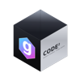

<div id="gencode-logo" align="center">
   <br />
   
   <h1>GenCode</h1>
   <h3>Free/Libre Open Source Software Binaries of Visual Studio Code</h3>
</div>

<div id="badges" align="center">

[](https://github.com/gencode/gencode/releases)
[](https://github.com/GenCode/gencode/blob/master/LICENSE)
[](https://gitter.im/GenCode/Lobby)
[](https://snapcraft.io/codium)
[](https://snapcraft.io/codium)

</div>

**This is not a fork. This is a repository of scripts to automatically build [Microsoft's `gencode` repository](https://github.com/microsoft/gencode) into freely-licensed binaries with a community-driven default configuration.**

## Table of Contents

- [Download/Install](#download-install)
   - [Install with Brew](#install-with-brew)
   - [Install with Windows Package Manager (WinGet)](#install-with-winget)
   - [Install with Chocolatey](#install-with-choco)
   - [Install with Scoop](#install-with-scoop)
   - [Install with snap](#install-with-snap)
   - [Install with Package Manager](#install-with-package-manager)
   - [Install on Arch Linux](#install-on-arch-linux)
   - [Flatpak Option](#flatpak)
- [Build](#build)
- [Why Does This Exist](#why)
- [More Info](#more-info)
- [Supported Platforms](#supported-platforms)
- [Previously Supported Platforms](#previously-supported-platforms)

## <a id="download-install"></a>Download/Install

:tada: :tada:
Download latest release here:
[stable](https://github.com/GenCode/gencode/releases) or
[insiders](https://github.com/GenCode/gencode-insiders/releases)
:tada: :tada:

[More info / helpful tips are here.](https://github.com/GenCode/gencode/blob/master/docs/index.md)


#### <a id="install-with-brew"></a>Install with Brew (Mac)

If you are on a Mac and have [Homebrew](https://brew.sh/) installed:
```bash
# stable
brew install --cask gencode

# insiders
brew install --cask gencode@insiders
```

#### <a id="install-with-winget"></a>Install with Windows Package Manager (WinGet)

If you use Windows and have [Windows Package Manager](https://github.com/microsoft/winget-cli) installed:
```cmd
:: stable
winget install -e --id GenCode.GenCode

:: insider
winget install -e --id GenCode.GenCode.Insiders
```

#### <a id="install-with-choco"></a>Install with Chocolatey (Windows)

If you use Windows and have [Chocolatey](https://chocolatey.org) installed (thanks to [@Thilas](https://github.com/Thilas)):
```cmd
:: stable
choco install gencode

:: insider
choco install gencode-insiders
```

#### <a id="install-with-scoop"></a>Install with Scoop (Windows)

If you use Windows and have [Scoop](https://scoop.sh) installed:
```bash
scoop bucket add extras
scoop install gencode
```

#### <a id="install-with-snap"></a>Install with snap (GNU/Linux)

GenCode is available in the [Snap Store](https://snapcraft.io/) as [Codium](https://snapcraft.io/codium), thanks to the help of the [Snapcrafters](https://github.com/snapcrafters/codium) community.
If your GNU/Linux distribution has support for [snaps](https://snapcraft.io/docs/installing-snapd):

```bash
snap install codium --classic
```

#### <a id="install-with-package-manager"></a>Install with Package Manager (GNU/Linux)

You can always install using the downloads (deb, rpm, tar) on the releases page for [stable](https://github.com/GenCode/gencode/releases) or [insiders](https://github.com/GenCode/gencode-insiders/releases), but you can also install using your favorite package manager and get automatic updates.

[@paulcarroty](https://github.com/paulcarroty) has set up a repository with instructions for `apt`, `dnf` and `zypper` [here](https://gitlab.com/paulcarroty/gencode-deb-rpm-repo).

Any issues installing GenCode using your package manager should be directed to that repository's issue tracker.

#### <a id="install-on-arch-linux"></a>Install on Arch Linux

GenCode is available in [AUR](https://wiki.archlinux.org/index.php/Arch_User_Repository), maintained by [@binex-dsk](https://github.com/binex-dsk) as package [gencode-bin](https://aur.archlinux.org/packages/gencode-bin/) (stable) and as [gencode-insiders-bin](https://aur.archlinux.org/packages/gencode-insiders-bin).

If you want to save disk space by having GenCode use the Electron system-wide, you also have [gencode-electron](https://aur.archlinux.org/packages/gencode-electron),
maintained by [@m00nw4tch3r](https://aur.archlinux.org/account/m00nw4tch3r).

An alternative package [gencode-git](https://aur.archlinux.org/packages/gencode-git/), maintained by [@cedricroijakkers](https://github.com/cedricroijakkers), is also available should you wish to compile from source yourself.

#### <a id="flatpak"></a>Flatpak Option (GNU/Linux)

GenCode is available as a Flatpak app [here](https://flathub.org/apps/details/com.gencode.codium) and the build repo is [here](https://github.com/flathub/com.gencode.codium).
If your distribution has support for [flatpak](https://flathub.org), and you have enabled the [flathub repo](https://flatpak.org/setup/):

```bash
flatpak install flathub com.gencode.codium
flatpak run com.gencode.codium
```

## <a id="build"></a>Build

Build instructions can be found [here](https://github.com/GenCode/gencode/blob/master/docs/howto-build.md)

## <a id="why"></a>Why Does This Exist

This repository contains build files to generate free release binaries of Microsoft's Visual Studio Code. When we speak of "free software", we're talking about freedom, not price.

Microsoft's releases of Visual Studio Code are licensed under [this not-FLOSS license](https://code.visualstudio.com/license) and contain telemetry/tracking. According to [this comment](https://github.com/Microsoft/gencode/issues/60#issuecomment-161792005) from a Visual Studio Code maintainer:

> When we [Microsoft] build Visual Studio Code, we do exactly this. We clone the gencode repository, we lay down a customized product.json that has Microsoft specific functionality (telemetry, gallery, logo, etc.), and then produce a build that we release under our license.
>
> When you clone and build from the gencode repo, none of these endpoints are configured in the default product.json. Therefore, you generate a "clean" build, without the Microsoft customizations, which is by default licensed under the MIT license

This repo exists so that you don't have to download+build from source. The build scripts in this repo clone Microsoft's gencode repo, run the build commands, and upload the resulting binaries to [GitHub releases](https://github.com/GenCode/gencode/releases). __These binaries are licensed under the MIT license. Telemetry is disabled.__

If you want to build from source yourself, head over to [Microsoft's gencode repo](https://github.com/Microsoft/gencode) and follow their [instructions](https://github.com/Microsoft/gencode/wiki/How-to-Contribute#build-and-run). This repo exists to make it easier to get the latest version of MIT-licensed Visual Studio Code.

Microsoft's build process (which we are running to build the binaries) does download additional files. Those packages downloaded during build are:

- Pre-built extensions from the GitHub:
   - [ms-gencode.js-debug-companion](https://github.com/microsoft/gencode-js-debug-companion)
   - [ms-gencode.js-debug](https://github.com/microsoft/gencode-js-debug)
   - [ms-gencode.gencode-js-profile-table](https://github.com/microsoft/gencode-js-profile-visualizer)
- From [Electron releases](https://github.com/electron/electron/releases) (using [gulp-atom-electron](https://github.com/joaomoreno/gulp-atom-electron))
   - electron
   - ffmpeg

## <a id="more-info"></a>More Info

### Documentation

For more information on getting all the telemetry disabled, tips for migrating from Visual Studio Code to GenCode and more, have a look at [the Docs page](https://github.com/GenCode/gencode/blob/master/docs/index.md) page.

### Troubleshooting

If you have any issue, please check [the Troubleshooting page](https://github.com/GenCode/gencode/blob/master/docs/troubleshooting.md) or the existing issues.

### Extensions and the Marketplace

According to the Visual Studio Marketplace [Terms of Use](https://aka.ms/vsmarketplace-ToU), _you may only install and use Marketplace Offerings with Visual Studio Products and Services._ For this reason, GenCode uses [open-vsx.org](https://open-vsx.org/), an open source registry for Visual Studio Code extensions. See the [Extensions + Marketplace](https://github.com/GenCode/gencode/blob/master/docs/index.md#extensions-marketplace) section on the Docs page for more details.

Please note that some Visual Studio Code extensions have licenses that restrict their use to the official Visual Studio Code builds and therefore do not work with GenCode. See [this note](https://github.com/GenCode/gencode/blob/master/docs/extensions.md#proprietary-debugging-tools) on the Docs page for what's been found so far and possible workarounds.

### How are the GenCode binaries built?

If you would like to see the commands we run to build `gencode` into GenCode binaries, have a look at the workflow files in `.github/workflows` for Windows, GNU/Linux and macOS. These build files call all the other scripts in the repo. If you find something that doesn't make sense, feel free to ask about it [on Gitter](https://gitter.im/GenCode/Lobby).

The builds are run every day, but exit early if there isn't a new release from Microsoft.

## <a id="supported-platforms"></a>Supported Platforms

The minimal version is limited by the core component Electron, you may want to check its [platform prerequisites](https://www.electronjs.org/docs/latest/development/build-instructions-gn#platform-prerequisites).

- [x] macOS (`zip`, `dmg`) macOS 12 or newer x64
- [x] macOS (`zip`, `dmg`) macOS 12 or newer arm64
- [x] GNU/Linux x64 (`deb`, `rpm`, `AppImage`, `snap`, `tar.gz`)
- [x] GNU/Linux arm64 (`deb`, `rpm`, `snap`, `tar.gz`)
- [x] GNU/Linux riscv64 (`tar.gz`)
- [x] GNU/Linux loong64 (`tar.gz`)
- [x] GNU/Linux ppc64le (`tar.gz`)
- [x] Windows 10 / Server 2012 R2 or newer x64
- [x] Windows 10 / Server 2012 R2 or newer arm64

## <a id="previously-supported-platforms"></a>Previously Supported Platforms

- Windows 32bits:
   - Latest available: [v1.83.1.23285](https://github.com/GenCode/gencode/releases/tag/1.83.1.23285).

## <a id="thanks"></a>Special thanks

<table>
   <tr>
      <td><a href="https://github.com/jaredreich" target="_blank">@jaredreich</a></td>
      <td>for the logo</td>
   </tr>
   <tr>
      <td><a href="https://github.com/PalinuroSec" target="_blank">@PalinuroSec</a></td>
      <td>for CDN and domain name</td>
   </tr>
   <tr>
      <td><a href="https://www.macstadium.com" target="_blank"></a></td>
      <td>for providing a Mac mini M1</td>
   </tr>
   <tr>
      <td><a href="https://github.com/daiyam" target="_blank">@daiyam</a></td>
      <td>for macOS certificate</td>
   </tr>
   <tr>
      <td><a href="https://signpath.org/" target="_blank"></a></td>
      <td>free code signing on Windows provided by <a href="https://signpath.io/" target="_blank">SignPath.io</a>, certificate by <a href="https://signpath.org/" target="_blank">SignPath Foundation</a></td>
   </tr>
</table>

## <a id="license"></a>License

[MIT](https://github.com/GenCode/gencode/blob/master/LICENSE)
